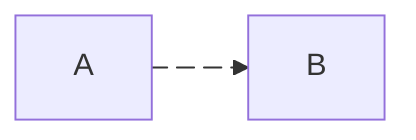

# Known issues and workarounds

Last reviewed: **2026-11-15**, against source commit `ad42f71`.

Installed releases may differ; check the [release notes](https://github.com/dev-hashemi/merlay/releases). Feature ideas belong in [PROPOSALS.md](PROPOSALS.md).

## Summary

Source preservation and validation are the priorities; grouping needs investigation, and mobile needs device testing.

| Issue | Tags |
| --- | --- |
| [Named-edge corruption](#named-flowchart-edges-can-be-corrupted-by-visual-edits) | `confirmed` `source-safety` `flowchart` |
| [Validation after saving](#structural-edits-can-be-saved-before-syntax-validation) | `confirmed` `source-safety` `both-hosts` |
| [Grouping changes node order](#grouping-can-change-node-order) · [#14](https://github.com/dev-hashemi/merlay/issues/14) | `reported` `layout` `flowchart` |
| [Mobile compatibility](#compatibility-checks-and-verification-gaps) | `unverified` `mobile` `pele` |

### Named flowchart edges can be corrupted by visual edits

In either host, renaming `B` in this valid source can turn the edge ID into a node, drop properties, and write invalid Mermaid:

**Workaround:** Edit named-edge diagrams in a text editor; in VS Code, use **Open With… → Text Editor**. **Next:** Preserve edge IDs/properties through node edits, edge operations, and duplication.

### Structural edits can be saved before syntax validation

Both hosts emit structural edits before renderer validation, so invalid source can reach the document. Valid syntax alone also cannot guarantee source preservation.

**Workaround:** Undo broken edits and inspect source in a text editor. **Next:** Validate before committing source/AST/history; reject failures and stale results across rapid edits, external changes, undo/redo, and closure.

### Grouping can change node order

Reported in [#14](https://github.com/dev-hashemi/merlay/issues/14); root cause is unconfirmed. Automatic layout changes must be distinguished from unnecessary source reordering.

**Workaround:** Undo grouping or adjust declaration/edge order in a text editor; exact placement remains renderer-controlled. **Next:** Reproduce and compare source ordering. [Visual reorder controls](PROPOSALS.md#1-visual-node-reordering-handle--grabber) remain a separate proposal.

## Compatibility checks and verification gaps

**Checked:** Obsidian Desktop 1.14.5/1.15.0 on Linux: selection, rename, delete, undo/redo, and saving across all five editable types; 1.15 also checked flowchart connections and light/dark SVG/PNG exports. Automated tests cover VS Code's bundled Mermaid.

**Unverified:** Physical iOS/Android devices after the Pele changes; desktop touch emulation was inconclusive. This is a testing gap. **Next:** Test editing, gestures, and saving on devices.

**Recent source fixes:** `5cabb51` (save targeting/recovery), `ad42f71` (Pele interactions/exports). Check release notes for package availability.

## Reporting and maintenance

Report [issues](https://github.com/dev-hashemi/merlay/issues) with Merlay/host versions, OS/device, minimal source, and expected/actual behavior. Link tracking issues and update status/workarounds as work progresses; record the release containing a fix before removing an entry.
