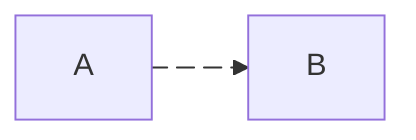

# Known issues and workarounds

Last reviewed **2026-11-24** for Merlay **0.6.7**.

Installed releases may differ; check the [release notes](https://github.com/dev-hashemi/merlay/releases). Feature ideas belong in [PROPOSALS.md](PROPOSALS.md).

## Summary

Merlay 0.6.7 checks visual edits before autosaving. Named-edge editing, grouping order, and mobile compatibility still need work.

| Issue | Tags |
| --- | --- |
| [Named-edge editing](#visual-editing-does-not-support-named-flowchart-edges) | `confirmed` `flowchart` |
| [Grouping changes node order](#grouping-can-change-node-order) · [#14](https://github.com/dev-hashemi/merlay/issues/14) | `reported` `layout` `flowchart` |
| [Mobile compatibility](#compatibility-checks-and-verification-gaps) | `unverified` `mobile` `pele` |

### Visual editing does not support named flowchart edges

In either host, renaming `B` visually in this diagram can generate an invalid candidate because the parser treats the edge ID as a node:

Merlay 0.6.7 rejects this candidate before saving and keeps the original source. Earlier versions could write malformed source to the document.

Edit named-edge diagrams in a text editor. In VS Code, use **Open With… → Text Editor**. Visual support requires preserving edge IDs and properties through node edits, edge operations, and duplication.

The syntax drawer writes manual edits as you type. Visual validation checks whether the proposed source renders. Preserving authored comments, settings, and diagram meaning also requires round-trip tests.

### Grouping can change node order

Reported in [#14](https://github.com/dev-hashemi/merlay/issues/14); root cause is unconfirmed. Automatic layout changes must be distinguished from unnecessary source reordering.

**Workaround:** Undo grouping or adjust declaration/edge order in a text editor; exact placement remains renderer-controlled. **Next:** Reproduce and compare source ordering. [Visual reorder controls](PROPOSALS.md#1-visual-node-reordering-handle--grabber) remain a separate proposal.

## Compatibility checks and verification gaps

**Checked:** Obsidian Desktop 1.14.5/1.15.0 on Linux: selection, rename, delete, undo/redo, and saving across all five editable types; 1.15 also checked flowchart connections and light/dark SVG/PNG exports. Automated tests cover VS Code's bundled Mermaid.

For 0.6.7, desktop smoke tests in Obsidian 1.15.1 and VS Code verified that valid visual edits save and that the named-edge example retains its original source after a rejected edit, in both Markdown fences and standalone Mermaid files.

**Unverified:** Physical iOS/Android devices after the Pele changes; desktop touch emulation was inconclusive. This is a testing gap. **Next:** Test editing, gestures, and saving on devices.

**Recent source fixes:** `5cabb51` (save targeting/recovery), `ad42f71` (Pele interactions/exports). Check release notes for package availability.

## Reporting and maintenance

Report [issues](https://github.com/dev-hashemi/merlay/issues) with Merlay/host versions, OS/device, minimal source, and expected/actual behavior. Link tracking issues and update status/workarounds as work progresses; record the release containing a fix before removing an entry.
